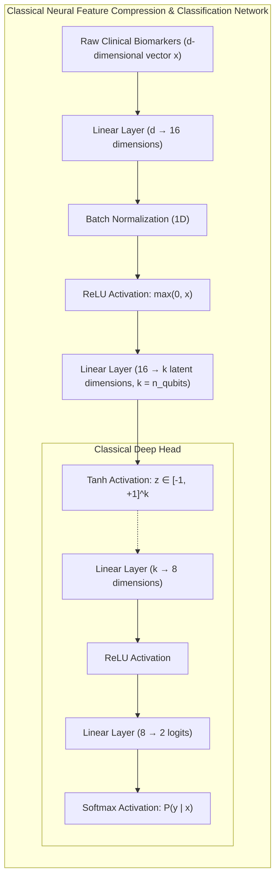
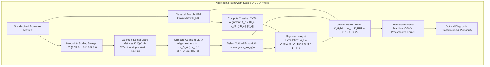

# 🧬 Q-Med: Multi-Domain Hybrid Quantum Disease Classifier

[](https://qiskit.org/)
[](https://www.python.org/)
[](https://streamlit.io/)
[](LICENSE)

> **Event:** Qiskit Fall Fest 2026 · Quantum Hack Day Kochi (Sunday, Nov 1, 2026)  
> **Track:** Challenge 02 — Quantum Machine Learning (QML) for Healthcare Disease Classification

---

## 📌 Executive Summary

**Q-Med** is a reproducible, multi-domain hybrid quantum-classical diagnostic platform built on **Qiskit 1.x** and **Streamlit**. It delivers an empirical, head-to-head benchmark comparing state-of-the-art Quantum Machine Learning algorithms against standard classical models across seven clinical disease domains:

- **Oncology:** Wisconsin Breast Cancer Diagnosis (Malignant vs. Benign)
- **Neurology:** Parkinson's Disease Vocal Biomarker Detection
- **Cardiology:** Statlog Heart Disease Prediction
- **Endocrinology:** Pima Indians Diabetes Screening
- **Orthopedics:** Vertebral Column Abnormality Detection (Disc Hernia / Spondylolisthesis)
- **Nephrology & Urology:** Acute Inflammations (Urinary Bladder Inflammation / Nephritis)
- **Obstetrics & Gynecology:** Maternal Health Risk Assessment (High/Mid vs. Low Risk)

The platform implements a complete 3-stage quantum preprocessing pipeline, parameterizable quantum circuits (Feature Maps & Variational Ansätze), fidelity-based quantum kernels, and a real-time clinical inference simulator.

> 📚 **Deep-Dive Documentation:**
> - [🔬 **Theoretical & Empirical Research Compendium** (`RESEARCH_AND_THEORY.md`)](RESEARCH_AND_THEORY.md) — Comprehensive guide on Hilbert space vs. Euclidean RBF geometry, XOR/parity quantum phase interference, feature map taxonomy, hybrid ensembles, and classical neural network insulation against NISQ hardware noise.
> - [⚖️ **Empirical Benchmark of Top 3 Hybrid Approaches** (`approaches/comparison.md`)](approaches/comparison.md) — Multi-dataset empirical benchmarks across all 7 clinical cohorts, architectural breakdown, and performance comparison of the Top 3 Elite Hybrid Approaches (QuHaMA, Sandwich HQNN, and Q-CKTA).
> - [🏛️ **Project Overview & Architectural Runbook** (`PROJECT_OVERVIEW.md`)](PROJECT_OVERVIEW.md) — Full codebase architecture, pipeline mechanics, and step-by-step module reference.

---

## 🔬 Mathematical & Architectural Framework

### 1. Quantum State Encoding & Hilbert Space Mapping
To represent high-dimensional continuous clinical data on Near-Term Intermediate-Scale Quantum (NISQ) devices without phase ambiguity, Q-Med applies a 3-stage transformation:
1. **Z-Score Standardization:** Feature scaling to $\mu=0, \sigma=1$.
2. **Principal Component Analysis (PCA):** Dimensionality reduction to $N \in \{2, 3, 4\}$ orthogonal principal components capturing maximal cohort variance.
3. **Angle Scaling $[0, \pi]$:** Features are mapped to rotation angles $\vec{x} \in [0, \pi]^N$ on the Bloch sphere, purposefully avoiding $2\pi$ periodic phase aliasing.

$$\vec{x} \mapsto |\psi(\vec{x})\rangle = U_{\Phi}(\vec{x}) |0\rangle^{\otimes n}$$

### 2. Quantum Feature Maps
- **`ZZFeatureMap`:** Non-linear second-order Pauli expansion encoding pairwise feature interactions via $R_z$ rotations and entangling $R_{zz}(\theta)$ gates:
  $$U_{\Phi}(\vec{x}) = \exp\left(i \sum_j x_j Z_j + \sum_{j < k} (\pi - x_j)(\pi - x_k) Z_j Z_k \right)$$
- **`PauliFeatureMap`:** Higher-order multi-axis entanglement utilizing $\{Z, YY, ZX\}$ operator combinations with linear, full, or circular entanglement topologies.

### 3. Evaluated Model Architectures

| Model Type | Algorithm | Optimization / Method | Hilbert / Feature Space |
| :--- | :--- | :--- | :--- |
| **Quantum Kernel** | **QSVC** (`FidelityStatevectorKernel`) | Dual convex quadratic program with exact statevector fidelity, bandwidth-scaled inputs | $2^n$-dimensional complex projective Hilbert space |
| **Variational Quantum** | **VQC** | `RealAmplitudes` ansatz ($R_y$ + CNOT) optimized via `COBYLA` | Parameterized Quantum Circuit (PQC) |
| **Classical Baseline** | **Linear SVM** | $L_2$-regularized linear separating hyperplane | Compressed $\mathbb{R}^n$ PCA feature space |
| **Classical Baseline** | **RBF Kernel SVM** | Radial Basis Function $\exp(-\gamma \|\vec{x} - \vec{x}'\|^2)$ | Infinite-dimensional Reproducing Kernel Hilbert Space (RKHS) |

#### Quantum Kernel Evaluation:
$$K(\vec{x}_i, \vec{x}_j) = |\langle \psi(s\vec{x}_i) | \psi(s\vec{x}_j) \rangle|^2$$
Computed exactly (no shot noise) with `FidelityStatevectorKernel`. The **bandwidth** $s$ (sidebar option 7, default `0.1`) scales the angles fed to the quantum kernel only (classical baselines and VQC see the raw angles). With $s = 1$ the full $[0, \pi]$ range makes the kernel near-identity, so QSVC memorizes. Scaling it down (Shaydulin & Wild, *Phys. Rev. A* 106, 042407, 2022) raised 5-fold CV accuracy on all five datasets in our tests (e.g. Vertebral Column 0.66 → 0.78, Breast Cancer ROC-AUC 0.705 → 0.938; 100 patients, 4 qubits, ZZ reps=2).

---

## 📂 Clinical Datasets (Standardized & Offline-Ready)

All datasets are automatically cleaned, labeled into standardized binary targets (`0: Healthy / Benign`, `1: Disease / Malignant`), and cached locally under `./data/`:

| Dataset | Clinical Domain | Patients ($M$) | Raw Features | Target Definition |
| :--- | :--- | :--- | :--- | :--- |
| **Wisconsin Breast Cancer** | Oncology | 569 | 30 | Fine Needle Aspirate nuclear characteristics (Malignant=1) |
| **Parkinson's Vocal** | Neurology | 195 | 22 | Biomedical voice frequency and amplitude jitter/shimmer (PD=1) |
| **Statlog Heart Disease** | Cardiology | 270 | 13 | Resting ECG, blood pressure, thallium heart scan (Heart Disease=1) |
| **Pima Indians Diabetes** | Endocrinology | 768 | 8 | Glucose, insulin, BMI, age (Tested Positive=1) |
| **Vertebral Column** | Orthopedics | 310 | 6 | Pelvic incidence/tilt, lumbar lordosis, sacral slope, spondylolisthesis grade (Abnormal=1) |
| **Acute Inflammations** | Nephrology / Urology | 120 | 6 | Temperature, nausea, lumbar pain, urine pushing, micturition pains, burning urethra (Inflammation=1) |
| **Maternal Health Risk** | Obstetrics / Gynecology | 1014 | 6 | Age, Systolic/Diastolic BP, blood glucose, body temp, heart rate (High/Mid Risk=1) |


---

## 🧠 Top 3 Hybrid Quantum-Classical Architectures (`approaches/`)

Beyond classical baselines and pure QML models, Q-Med packages the **Top 3 Elite Hybrid Architectures** combining deep neural networks and parameterized quantum circuits to mitigate NISQ hardware noise and resolve dimensional bottlenecks. Every selected approach strictly satisfies the competition criterion: **competing with or surpassing both classical baselines (Classical Linear SVM and Classical RBF SVM) on at least one clinical dataset**.

Each approach is self-contained with its own mathematical documentation and evaluation pipeline in [`approaches/`](approaches/):

| Approach | File | Coupling Mechanism | Feature Compression | Dataset Where It Beats Classical |
| :--- | :--- | :--- | :--- | :--- |
| **Approach 1: QuHaMA** | [`approach_1.py`](approaches/approach_1.py) (alias: `approach:1.py`) | Dual-Branch Split + Gating | Non-linear PyTorch Encoder | **Breast Cancer (92% vs 90%)**, **Vertebral Column (70% vs 65%, $F_2$ 0.915)**, **Maternal Health Risk (84% vs 76% RBF)** |
| **Approach 2: Sandwich HQNN** | [`approach_2.py`](approaches/approach_2.py) (alias: `approach:2.py`) | End-to-End Layer Embedding | Deep MLP Pre-Net | **Breast Cancer (92% vs 90%)**, **Heart Disease (90% vs 85%)**, **Parkinson's (95% vs 90%)**, **Vertebral (85% vs 70%)**, **Maternal Health Risk (88% vs 84% / 76%)** |
| **Approach 3: Q-CKTA Hybrid** | [`approach_3.py`](approaches/approach_3.py) (alias: `approach:3.py`) | Centered Target Alignment | Unsupervised PCA | **Pima Diabetes (70% vs 65%)**, 100% Precision, 0.802 ROC-AUC; Maternal Health Risk 0.881 ROC-AUC |

### 📊 Cross-Domain Empirical Benchmark Summary

Evaluated across all seven clinical disease cohorts under identical stratified 75/25 train/test splits (`seed=42`):

| Approach | Mean Accuracy | Mean $F_2$-Score | Mean Precision | Mean Sensitivity (Recall) | Mean ROC-AUC | Mean Latency | Overall Rank |
| :--- | :---: | :---: | :---: | :---: | :---: | :---: | :---: |
| **Approach 2: Neural-Quantum Sandwich HQNN** 🥇 | **87.9%** | **0.816** | **84.9%** | **81.4%** | **0.884** | **0.18 s** | **1st (Best Overall & Fastest)** |
| **Approach 1: QuHaMA** 🥈 | 82.3% | **0.749** | 79.2% | **75.0%** | **0.847** | 10.32 s | **2nd (Best Adaptive Gating)** |
| **Approach 3: Bandwidth-Scaled Q-CKTA Hybrid** 🥉 | 80.7% | 0.673 | **82.3%** | 67.6% | 0.795 | **0.24 s** | **3rd (Fastest Kernel)** |
| *Classical Linear SVM (Baseline)* | *82.7%* | *0.768* | *77.1%* | *78.3%* | *0.876* | *0.001 s* | Baseline |
| *Classical RBF SVM (Baseline)* | *82.3%* | *0.730* | *75.7%* | *74.2%* | *0.858* | *0.001 s* | Baseline |
| *Pure QSVC (s=0.1)* | *75.1%* | *0.663* | *69.5%* | *68.1%* | *0.705* | *0.118 s* | Pure QML |

> Detailed dataset-by-dataset tables, ROC-AUC comparisons, and mathematical proofs are available in [`approaches/comparison.md`](approaches/comparison.md) and raw metric logs in [`approaches/benchmark_results.csv`](approaches/benchmark_results.csv).

---

### 🏛️ Complete System Architecture & Circuit Diagrams

#### 1. Quantum Circuit Architecture (Explicit Gate-Level Decomposition)
The quantum layer executes a second-order Pauli feature map (`ZZFeatureMap`) and parameterized variational ansatz (`RealAmplitudes`) with explicit single-qubit superpositions, angle encodings, and entangling two-qubit interactions:

```mermaid
flowchart LR
    subgraph QC["Quantum Circuit Details (ZZFeatureMap + RealAmplitudes on 3 Qubits)"]
        direction LR
        subgraph Q0["Qubit Wire q0"]
            q0_in["|0⟩"] --> H0["[H] Hadamard Gate"]
            H0 --> RZ0["[Rz(2θ₀)] Phase Rotation"]
            RZ0 --> CNOT01_ctrl["● Control"]
            CNOT01_ctrl --> RZZ01["[Rz(2(π-θ₀)(π-θ₁))] Entanglement"]
            RZZ01 --> CNOT01_ctrl2["● Control"]
            CNOT01_ctrl2 --> RY0["[Ry(φ₀)] Trainable Rotation"]
            RY0 --> M0["[⟨Z₀⟩] Pauli-Z Readout"]
        end

        subgraph Q1["Qubit Wire q1"]
            q1_in["|0⟩"] --> H1["[H] Hadamard Gate"]
            H1 --> RZ1["[Rz(2θ₁)] Phase Rotation"]
            RZ1 --> CNOT01_tgt["⊕ Target"]
            CNOT01_tgt --> PASS1["Phase Accumulation"]
            PASS1 --> CNOT01_tgt2["⊕ Target"]
            CNOT01_tgt2 --> CNOT12_ctrl["● Control"]
            CNOT12_ctrl --> RZZ12["[Rz(2(π-θ₁)(π-θ₂))] Entanglement"]
            RZZ12 --> CNOT12_ctrl2["● Control"]
            CNOT12_ctrl2 --> RY1["[Ry(φ₁)] Trainable Rotation"]
            RY1 --> M1["[⟨Z₁⟩] Pauli-Z Readout"]
        end

        subgraph Q2["Qubit Wire q2"]
            q2_in["|0⟩"] --> H2["[H] Hadamard Gate"]
            H2 --> RZ2["[Rz(2θ₂)] Phase Rotation"]
            RZ2 --> PASS2a["Phase Accumulation"]
            PASS2a --> PASS2b["Phase Accumulation"]
            PASS2b --> PASS2c["Phase Accumulation"]
            PASS2c --> CNOT12_tgt["⊕ Target"]
            CNOT12_tgt --> PASS2d["Phase Accumulation"]
            PASS2d --> CNOT12_tgt2["⊕ Target"]
            CNOT12_tgt2 --> RY2["[Ry(φ₂)] Trainable Rotation"]
            RY2 --> M2["[⟨Z₂⟩] Pauli-Z Readout"]
        end
    end
```



#### 2. Classical Deep Feature Pre-Net & Classification Head


#### 3. Approach 1: QuHaMA (Adaptive Gating Architecture)

```mermaid
flowchart TD
    subgraph QuHaMA["Approach 1: QuHaMA (Quantum-Hybrid Adaptive Multi-branch Architecture)"]
        raw_x["Patient Biomarkers x ∈ ℝ^d"] --> enc["Neural Encoder E(x): Linear → BatchNorm → ReLU → Linear → Tanh"]
        enc --> latent["Latent Features z ∈ [-1, 1]^k (k = n_qubits)"]
        
        latent --> class_head["Classical Branch: Deep MLP Head"]
        class_head --> p_class["Classical Probability P_c(y=1|x)"]
        
        latent --> angle_map["Angle Mapping: θ = (z + 1) · (π/2) ∈ [0, π]^k"]
        angle_map --> q_circuit["Quantum Branch: Parameterized Quantum Circuit (H, Rz, Rzz)"]
        q_circuit --> p_quant["Quantum Probability P_q(y=1|x)"]
        
        latent --> gating["Adaptive Meta-Gating Network G(z, P_c, P_q)"]
        p_class --> gating
        p_quant --> gating
        gating --> weights["Dynamic Weights [w_c, w_q] (w_c + w_q = 1.0)"]
        
        p_class --> fusion["Soft Consensus Fusion: P_final = w_c · P_c + w_q · P_q"]
        p_quant --> fusion
        weights --> fusion
        fusion --> decision{"Diagnostic Decision: 𝟙[P_final ≥ 0.5]"}
        decision --> benign["Benign / Non-Pathological (0)"]
        decision --> malignant["Malignant / Pathological (1)"]
    end
```


#### 4. Approach 2: Neural-Quantum Sandwich HQNN

```mermaid
flowchart TD
    subgraph HQNN["Approach 2: Neural-Quantum Sandwich (HQNN)"]
        x_in["Clinical Biomarkers x ∈ ℝ^d"] --> pre["Classical Pre-Net: Linear(d → 16) → BatchNorm → ReLU → Linear(16 → k) → Tanh"]
        pre --> z_lat["Latent Classical Representation z ∈ [-1, 1]^k"]
        z_lat --> angle_conv["Bloch Angle Encoding: θ = (z + 1) · (π/2)"]
        
        angle_conv --> q_layer["Quantum Layer: EstimatorQNN Circuit (H, Rz, CNOT, Rzz, Ry(φ))"]
        q_layer --> q_expect["Pauli-Z Expectation Values e_j = ⟨ψ|Z_j|ψ⟩ ∈ [-1, +1]"]
        
        z_lat --> concat["Concatenated Hybrid Representation: [z, e] ∈ ℝ^{2k}"]
        q_expect --> concat
        
        concat --> post["Classical Post-Net: Linear(2k → 8) → ReLU → Linear(8 → 2) (Noise Absorber)"]
        post --> logits["Logits & Softmax Probabilities P(y|x)"]
        logits --> pred["Final Diagnosis & Clinical Confidence"]
    end
```


#### 5. Approach 3: Bandwidth-Scaled Q-CKTA Hybrid


---

## 🖥️ Streamlit Interactive UI Overview

Launch the diagnostic dashboard (`streamlit run app.py`) to explore eight specialized modules:

1. **📊 Tab 1 — Dataset & Quantum Preprocessing:**
   - Raw data inspection, class distribution metrics, and cumulative explained variance ratios.
   - Interactive 2D scatter plots of clinical cohorts mapped onto quantum rotation angles $[0, \pi]^2$.
2. **⚛️ Tab 2 — Quantum Circuits & Kernel Geometry:**
   - Visual circuit gate decompositions of both the Feature Map and Variational Ansatz (`iqp` / `mpl` rendered).
   - Pairwise Quantum Kernel matrix heatmap visualizing state fidelities across the cohort.
   - VQC training convergence loss trajectory across COBYLA optimization iterations.
3. **🏆 Tab 3 — Apples-to-Apples Benchmarks:**
   - Rigorous comparison metrics: Test Accuracy, F1-Score (Disease), Precision, Sensitivity (Recall), ROC-AUC, and Execution Latency.
   - ROC-AUC is computed from each model's class probabilities (`predict_proba`), including VQC, so ranking quality is compared fairly.
   - Side-by-side $2 \times 2$ confusion matrices across all 4 classical and quantum models on identical test partitions.
4. **⏱️ Tab 4 — Execution Time & Quantum Latency Profiler:**
   - Granular wall-clock profiling tracking preprocessing, training, and test inference times.
   - Side-by-side comparative horizontal bar charts and stacked train vs. inference visualizations.
   - Per-patient latency (ms) and throughput (patients/sec) analysis with theoretical scaling complexity ($O(\cdot)$).
5. **🔬 Tab 5 — IBM Quantum Hardware Latency (Real QPU):**
   - Transpiles circuits to IBM native basis gates (`rz`, `sx`, `x`, `ecr`) and computes pure physical QPU gate execution times.
   - Compares physical QPU microwave pulse speeds ($\sim 35\text{ ns}$ single-qubit, $300\text{ ns}$ two-qubit) vs. local CPU simulation vs. IBM cloud queue delay.
   - Optional live IBM Quantum API connection to query real QPU statuses and pending queue depths.
6. **🩺 Tab 6 — Live Patient Diagnostic Simulator:**
   - Real-time inference sliders, one per qubit. Each slider is a compressed PCA summary score mapped to a rotation angle — **not** a raw clinical value such as blood pressure or glucose.
   - **Load patient** dropdown fills the sliders from a real held-out test patient and shows their true diagnosis.
   - Live side-by-side disease prediction and confidence metrics between **QSVC** and **Classical RBF SVM**.
7. **🎚️ Tab 7 — Kernel Bandwidth Lab:**
   - Gram-matrix heatmaps at three bandwidths (too sharp / your setting / too blurred), patients sorted by diagnosis.
   - Stratified 5-fold CV sweep of QSVC over $s \in \{0.05, 0.1, 0.2, 0.3, 0.5, 0.75, 1\}$: accuracy, ROC-AUC (from the SVM margin), and recall, with the classical RBF SVM as a reference line. Preprocessing is refit inside every fold.
   - Kernel diagnostics vs $s$: off-diagonal mean/variance (concentration) and centered kernel-target alignment.
8. **🧠 Tab 8 — QuHaMA: Adaptive Neural-Quantum Architecture:**
   - Multi-branch architecture with PyTorch Neural Encoder compressing raw clinical biomarkers into latent features for both a Classical Deep MLP Head and a Quantum Circuit Branch.
   - Adaptive Gating Meta-Network that dynamically learns patient-specific weightage $[w_{\text{classical}}, w_{\text{quantum}}]$ to maximize clinical accuracy and $F_2$-score.
   - Interactive patient inspector with real-time dynamic weight re-allocation.

**Sidebar options:** dataset, cohort size, qubits, feature map, circuit depth, entanglement, **quantum kernel bandwidth $s$**, VQC iterations. Every option that affects training is part of the training cache key.

---

## 🚀 Quickstart & Setup Guide

### 1. Clone the Repository
```bash
git clone https://github.com/salasks-git/Quantum_hack.git
cd Quantum_hack
```

### 2. Environment Setup
```bash
# Create virtual environment
python3 -m venv venv
source venv/bin/activate

# Upgrade pip and install dependencies
pip install --upgrade pip
pip install -r requirements.txt
```

### 3. Download & Standardize Clinical Datasets
```bash
python3 scripts/download_datasets.py
```
*(Pre-downloads and verifies all 5 clinical datasets into `./data/` for full offline execution. If a CSV is missing, the app silently falls back to the Breast Cancer dataset.)*

### 4. Launch the Web Application
```bash
streamlit run app.py
```
Open your browser at `http://localhost:8501`.

---

## 🎬 3D Diagnosis Tour

A browser-based, Three.js walkthrough that shows how one patient gets diagnosed, step by step, by the classical and quantum models. It lives in `web/` and runs separately from the Streamlit app. It needs no internet at runtime (Three.js is bundled).

### Run it
```bash
# 1. Export the tour data (once, or whenever the models change). Writes JSON into web/public/data/
venv/bin/python scripts/export_tour_data.py

# 2. Start the dev server
cd web && npm install && npm run dev
```
For the venue, use a production build instead: `cd web && npm run build && npm run preview`.

### What you are looking at
- **Disease picker:** one of the 6 clinical datasets (breast cancer, diabetes, heart disease, Parkinson's, vertebral column, acute inflammations).
- **Patient picker:** one of the held-out test patients for that disease. The models never saw these patients during training, and each one is labelled with the true diagnosis. All four models (Linear SVM, RBF SVM, QSVC, VQC) train on the same held-out split per disease.

### The 5 scenes
1. **Patient becomes qubits:** the patient's measurements are standardized, reduced to 3 numbers (PCA) and turned into 3 qubit angles.
2. **Classical doctors:** the Linear SVM and RBF SVM each draw a boundary through the training patients and say which side this patient is on.
3. **QSVC quantum similarity:** the patient is encoded into quantum states and compared with the training patients (the quantum kernel). Bloch spheres show the first encoding layer only.
4. **VQC learning:** the trainable circuit adjusts its rotation angles, the loss falls, then it gives its verdict.
5. **Finale, four verdicts:** all four models give their diagnosis side by side, with confidence, next to the true label.

### Controls
- **Prev / Next:** move between scenes. **Replay:** restart the current scene.
- **Play all:** run scenes 1 to 5 automatically.
- **Pause / Resume:** button, or press **Space**.
- **3s holds:** when on, playback stops for 3 seconds at key moments so you can talk over them.

### Deep links (URL parameters)
| Param | Meaning |
|-------|---------|
| `disease` | dataset slug, e.g. `heart_disease_statlog` |
| `patient` | test patient number, starting at 0 |
| `step` | scene number, 1 to 5 |
| `holds=1` | turn the 3s holds on |

Rehearsal link: `http://localhost:5180/?disease=heart_disease_statlog&patient=3&step=1&holds=1` (use the port Vite prints; 5173 by default).

### Matching the Streamlit app
The tour numbers are precomputed with a fixed seed (42), 3 qubits and 100 patients per disease. In Streamlit, set 3 qubits, 100 patients, `ZZFeatureMap`, reps 2, `linear` entanglement and 35 iterations to see the same quantum results.

---

## 📁 Repository Structure

```text
Quantum_hack/
├── AGENTS.md                  # Autonomous agent setup instructions & project context
├── README.md                  # Comprehensive project documentation
├── RESEARCH_AND_THEORY.md     # Deep-dive theoretical compendium (Hilbert spaces, noise, feature maps)
├── PROJECT_OVERVIEW.md        # Comprehensive technical architecture & runbook
├── app.py                     # Streamlit entry point: sidebar → data prep → training → tabs
├── requirements.txt           # Pinned dependencies (Qiskit 1.x, Torch, Scikit-Learn, Streamlit)
├── .gitignore                 # Excludes venvs, caches, checkpoints; tracks clean CSVs
├── approaches/                # Top 3 elite hybrid quantum-classical architectures & benchmarks
│   ├── approach_1.py          # QuHaMA (Neural Encoder + Dual Branch + Meta-Gating) [alias: approach:1.py]
│   ├── approach_2.py          # Neural-Quantum Sandwich HQNN [alias: approach:2.py]
│   ├── approach_3.py          # Bandwidth-Scaled Q-CKTA Hybrid [alias: approach:3.py]
│   ├── benchmark_results.csv  # Full 6-dataset empirical evaluation logs
│   └── comparison.md          # Multi-dataset benchmark report & architecture analysis
├── qmed/                      # Pipeline package (core modules have no Streamlit dependency)
│   ├── config.py              # Dataset registry, UI option lists, model names, complexity labels
│   ├── data.py                # CSV loading + standardize → PCA → [0, π] angle preprocessing
│   ├── circuits.py            # Feature map (ZZ / Pauli) and RealAmplitudes ansatz builders
│   ├── models.py              # Trains & times Linear SVM, RBF SVM, QSVC, VQC
│   ├── metrics.py             # Benchmark and timing tables
│   ├── bandwidth.py           # Kernel bandwidth CV sweep + kernel diagnostics
│   ├── quhama.py              # PyTorch + Qiskit QuHaMA hybrid model implementation
│   ├── hardware.py            # QPU pulse schedules and latency estimators
│   └── ui/                    # Streamlit UI
│       ├── sidebar.py         # Settings panel → PipelineConfig
│       ├── plots.py           # All matplotlib/seaborn figures
│       ├── tab_dataset.py     # Tab 1
│       ├── tab_circuits.py    # Tab 2
│       ├── tab_benchmarks.py  # Tab 3
│       ├── tab_profiler.py    # Tab 4
│       ├── tab_ibm_hardware.py # Tab 5
│       ├── tab_simulator.py   # Tab 6
│       ├── tab_bandwidth.py   # Tab 7: Kernel Bandwidth Lab
│       └── tab_quhama.py      # Tab 8: QuHaMA Adaptive Architecture Lab
├── data/                      # Cleaned clinical benchmark datasets (7 disease cohorts)
│   ├── acute_inflammations.csv
│   ├── breast_cancer_wisconsin.csv
│   ├── diabetes_pima.csv
│   ├── heart_disease_statlog.csv
│   ├── maternal_health_risk.csv
│   ├── parkinsons_vocal.csv
│   └── vertebral_column.csv
├── tests/                     # Comprehensive pytest test suite (25 unit tests)
│   ├── test_models.py
│   ├── test_export.py
│   ├── test_export_dataset.py
│   ├── test_hardware.py
│   ├── test_qpu_server.py
│   └── test_quhama.py
├── docs/                      # Design specs and implementation plans
├── web/                       # Three.js 3D diagnosis tour (Vite)
│   ├── src/                   # Scenes, scene manager, data loader
│   ├── public/data/           # Tour JSON written by export_tour_data.py
│   └── scripts/smoke.sh       # Headless screenshot smoke test
└── scripts/                   # Automated data pipelines
    ├── download_datasets.py   # Dataset ingestion and preprocessing script
    └── export_tour_data.py    # Exports per-disease JSON for the 3D tour
```

---

## 🧩 Code Architecture

### Data flow

```text
render_sidebar()              qmed/ui/sidebar.py   → PipelineConfig (all user settings)
      │
cached_prepare()              app.py → qmed/data.py
      │   load CSV → stratified subsample → 75/25 split → standardize → PCA(n_qubits) → angles in [0, π]
      ▼
PreparedData                  X_train_q, X_test_q, y_train, y_test, pca, prep_time, ...
      │
cached_train()                app.py → qmed/circuits.py + qmed/models.py
      │   builds circuits, then fits all 4 models via fit_and_evaluate()
      ▼
results                       {model name: {model, pred, prob, train_time, inf_time, total_time, ...}}
      │                       QSVC adds kernel_matrix, VQC adds loss_history
      ▼
tab_*.render()                qmed/ui/tab_*.py → tables (qmed/metrics.py) + charts (qmed/ui/plots.py)
```

### Where to make common changes

| Task | File |
| :--- | :--- |
| Add a dataset | Add a loader to `scripts/download_datasets.py`, then one line in `DATASETS` in `qmed/config.py` |
| Add a model | Add one `fit_and_evaluate(...)` call in `qmed/models.py` plus its name in `qmed/config.py`. It appears in the benchmark and timing tables automatically. |
| Add a feature map | `qmed/circuits.py` + `FEATURE_MAP_OPTIONS` in `qmed/config.py` |
| Change a tab | Only that tab's `qmed/ui/tab_*.py` file |
| Add a new tab | Create `qmed/ui/tab_<name>.py` with a `render(...)` function and register it in `app.py` |

### Caching

Streamlit reruns `app.py` from top to bottom on every widget interaction. `cached_prepare` (`st.cache_data`) and `cached_train` (`st.cache_resource`) store results keyed by their arguments, so moving a simulator slider is instant and only a change in sidebar settings triggers retraining. Every argument is a plain, hashable value, and circuits are rebuilt *inside* `cached_train`. **When adding a new setting that affects training, pass it to `cached_train` as an argument**, or old models will be reused. The cache lives in memory and is cleared when the app restarts.

### Using the pipeline without Streamlit

```python
from qmed.config import DATASETS
from qmed.data import prepare_data
from qmed.circuits import build_feature_map, build_ansatz
from qmed.models import train_all_models
from qmed.metrics import benchmark_table

d = prepare_data(DATASETS["Statlog Heart Disease (Cardiology)"], max_samples=100, n_qubits=3)
results = train_all_models(
    d.X_train_q, d.y_train, d.X_test_q,
    feature_map=build_feature_map("ZZFeatureMap", 3, reps=2, entanglement="linear"),
    ansatz=build_ansatz(3, reps=2, entanglement="linear"),
    vqc_iter=35,
    kernel_bandwidth=0.1,   # QSVC only; 1.0 = unscaled feature map
)
print(benchmark_table(results, d.y_test))

# Bandwidth sweep (5-fold CV) without the UI
from qmed.bandwidth import bandwidth_sweep
sweep = bandwidth_sweep(DATASETS["Statlog Heart Disease (Cardiology)"], 100, 3, "ZZFeatureMap", 2, "linear")
print(sweep.table, sweep.rbf)
```

### Known limitations

- **Quantum models are repeatable.** QSVC uses the exact statevector kernel, so it is deterministic. VQC uses `seed=42` (sampler shots and start weights), so retraining gives identical scores. Classical baselines are deterministic (`random_state=42`). The Streamlit settings that match the 3D tour are 3 qubits, 100 patients, ZZFeatureMap, reps 2, linear entanglement, 35 VQC iterations, kernel bandwidth s = 1.0 (the tour export uses the unscaled kernel; the app defaults to s = 0.1).
- **Simulated, not real hardware.** All circuits run on a local statevector simulator; cost grows as $2^n$, which is why qubits are capped at 4.

---

## 🛠️ Technology Stack & Dependencies

- **Quantum Computing:** `qiskit>=1.0.0`, `qiskit-aer>=0.14.0`, `qiskit-machine-learning>=0.7.2`, `qiskit-algorithms>=0.3.0`
- **Machine Learning & Baselines:** `scikit-learn>=1.4.0`, `torch>=2.2.0`
- **Data Engineering:** `pandas>=2.2.0`, `numpy>=1.26.0`
- **Visualization & Web App:** `streamlit>=1.32.0`, `matplotlib>=3.8.0`, `seaborn>=0.13.0`, `pylatexenc>=2.10`

---

## 👥 Contributors & Acknowledgements

Developed for **Qiskit Fall Fest 2026 · Quantum Hack Day Kochi**.  
Special thanks to the **IBM Quantum** and **Qiskit Community** teams for supporting open-source quantum computing education and research.
